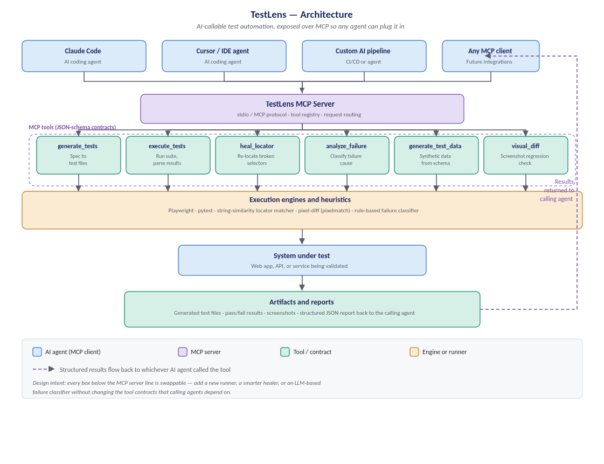

# TestLens

AI-callable test automation, exposed as an **MCP server** so any MCP-compatible agent (Claude Code, Cursor, custom pipelines) can generate, run, triage and heal tests without bespoke integration code.



## Tools

| Tool | Purpose |
|---|---|
| `generate_tests` | Steps -> runnable Playwright (`.spec.ts`) or pytest file |
| `execute_tests` | Run a file/dir, return structured pass/fail + categorized failures |
| `heal_locator` | Rank replacement selectors for a broken one (similarity baseline) |
| `analyze_failure` | Classify a failure: assertion / timeout / element-not-found / network / environment |
| `generate_test_data` | Seeded synthetic records from a JSON Schema subset |
| `visual_diff` | Pixel diff of two PNGs with threshold and diff image |

Contracts live in `src/schemas.ts`. Every engine behind a tool is swappable (e.g. replace the rule-based classifier or similarity healer with an LLM call) without changing the contract.

## Quick start

```bash
npm install
npx playwright install chromium   # only needed to execute Playwright tests
npm run build
npm test
```

## Use from an MCP client

Add to your client's MCP config (Claude Desktop / Claude Code / Cursor):

```json
{
  "mcpServers": {
    "testlens": {
      "command": "node",
      "args": ["C:/Users/purvi/Documents/GitHub/testlens/dist/index.js"]
    }
  }
}
```

Then ask the agent: *"Use testlens to generate a Playwright test from examples/sample-spec.json and run it."*

## Status and roadmap

v0.1 is an MVP scaffold. Known limits: `execute_tests` parses console output (switch to JSON reporters for exact results); `heal_locator` and `analyze_failure` are heuristic baselines; `visual_diff` needs same-size PNGs. Next: LLM-backed healing/classification, JSON reporters, REST/CLI wrapper, more runners.

[](https://m8ven.ai/mcp/ptrivedi74-testlens-12svad?s=readme)

## License
MIT
